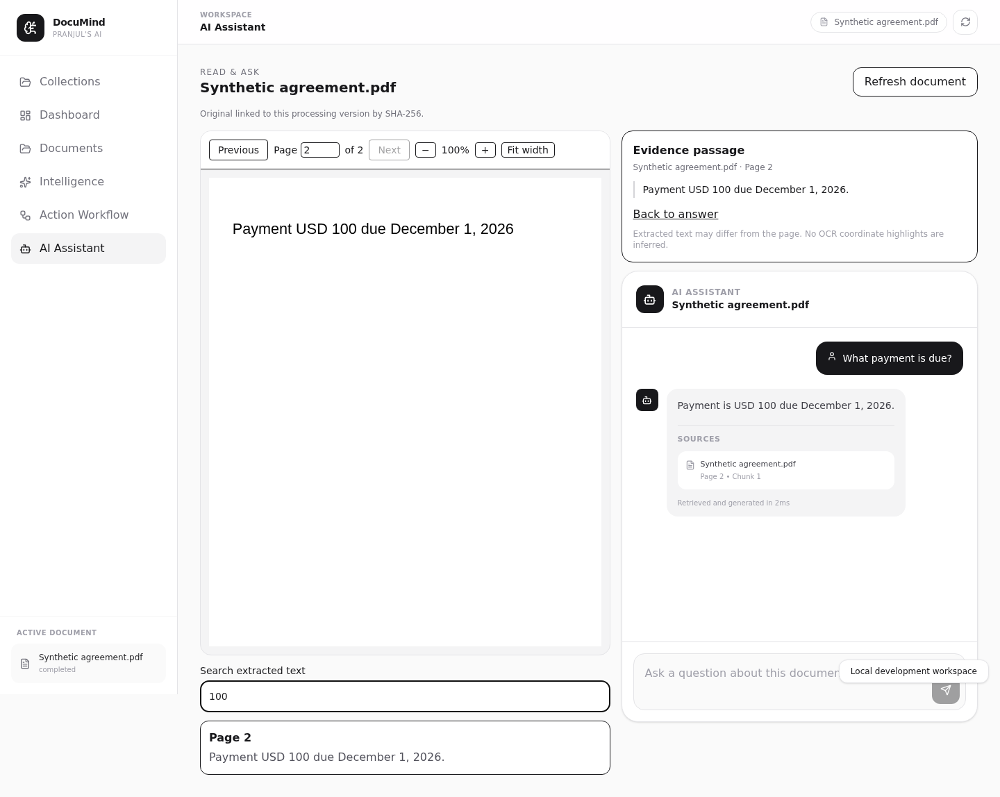
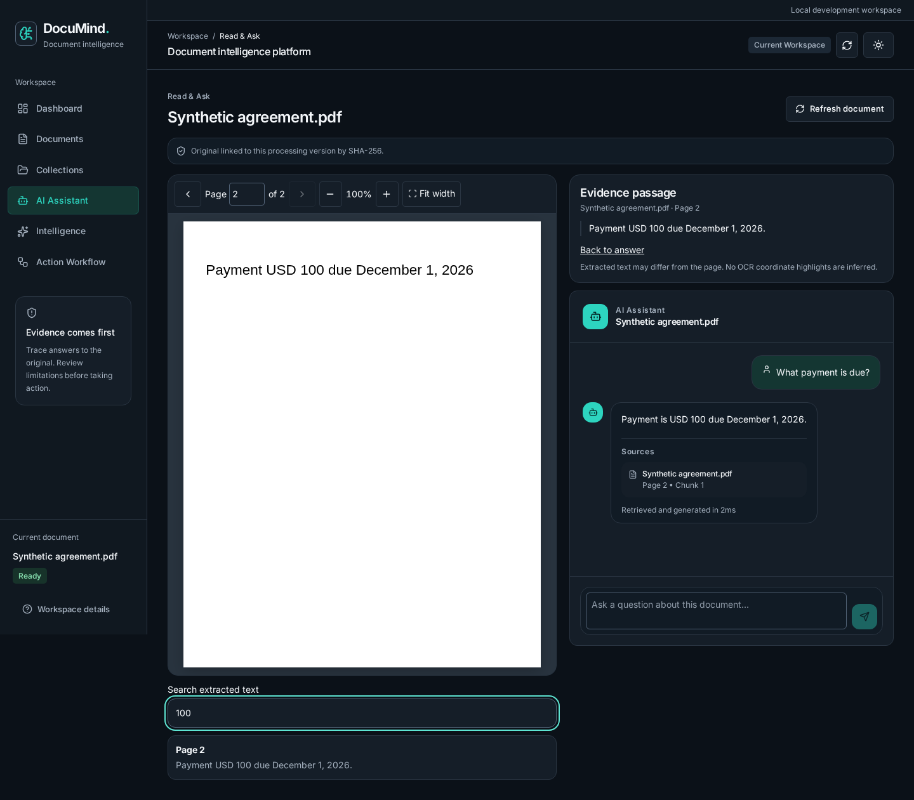
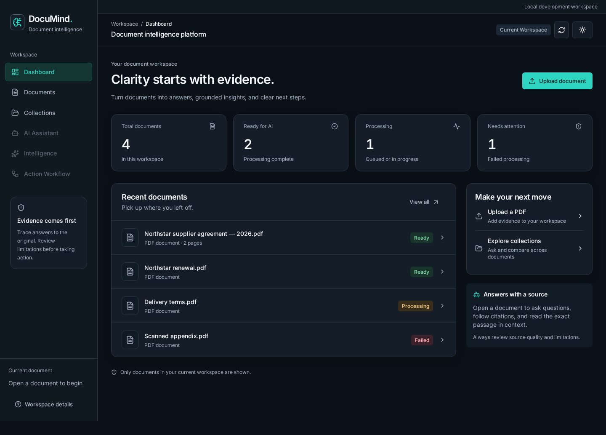

# Actual browser captures — synthetic fixtures only

Before: Chromium captures from the final stability regression run on stable main `b10554ea3572773242807a9229b5086af7bfc7af`. After: the same original six-scenario test suite on the redesign branch. Desktop reader: 1440 px. Mobile reader: 390 px. Both use the same synthetic PDF/citation fixture. Files are unedited browser screenshots, not design mockups.

| Reader | Before | After |
| --- | --- | --- |
| Desktop | [Before](before-reader-desktop.png) | [After](after-reader-desktop.png) |
| Mobile | [Before](before-reader-mobile.png) | [After](after-reader-mobile.png) |

Dashboard captures use the new reproducible `enterprise-ui.spec.js` synthetic dataset: four documents, two ready, one processing, one failed. This dataset is intercepted in the browser and is not written to Atlas or presented as real analytics in the product.

| Theme | Desktop, 1440 px | Mobile, 360 px |
| --- | --- | --- |
| Dark | [Dark desktop](dark-dashboard.png) | [Dark mobile](dark-mobile.png) |
| Light | [Light desktop](light-dashboard.png) | [Light mobile](light-mobile.png) |

The full suite also captures library/upload, reader, intelligence, workflow, and collection/comparison/report views at 360, 768, 1280 and 1440 px in both themes. Those captures are in the CI `browser-evidence` artifact. Automated visual-layout assertions and Axe checks are supplemented by direct screenshot inspection. This is not a comprehensive screen-reader or WCAG certification.
